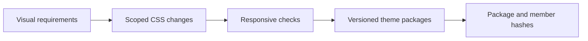

# Hospitality interface refresh

**Focus:** responsive interface maintenance, visual theming and verifiable release packaging.

**Public presentation:** an anonymized case study with an original process diagram. Client names, marks, photography, operational URLs and installation packages are deliberately outside this showcase.

## The problem

A legacy hospitality interface needed to support different visual identities while retaining its native controls. Responsive issues also needed focused repairs without changing the booking engine’s behavior.

## The contribution

- Develop and refine CSS presentation across five property themes.
- Make narrowly scoped responsive layout repairs, including dialog positioning after viewport changes.
- Preserve the distinction between visual theme files and platform-owned booking logic.
- Package versioned artifacts with file manifests so the handover can be checked against exact contents.

## What was verified

On **26 October 2026**, an independent read of the reviewed release artifacts matched **five package SHA-256 hashes and all 660 listed file hashes**. The checked packages contained no HTML or JavaScript files. These checks inspected package contents without running repository code.

The source handover also records responsive checks and retained failures. Those dated reports describe their own test conditions; this portfolio review did not repeat live booking or administration operations.

## What this does not establish

This is interface and release-engineering work. It is not authorship of the underlying booking engine, a complete security/accessibility certification, a verified business uplift, or proof that every user received a particular deployment. Checkout, holds, payments and live booking changes were not tested by this review.

Third-party software and property media retain their original ownership and licensing. Only this anonymized explanation and original diagram are included here.

[Back to the portfolio](../README.md)
