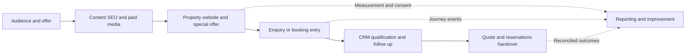

# Connecting the hospitality marketing value stream

**Papi Mashamba · Extraordinary Resorts · Portfolio review October 2026**

## The business problem

Campaigns depend on more than media delivery. A guest must find the right property, understand the offer, move into an enquiry or booking journey and receive an effective reservations handover. Disconnected websites, tracking and customer records make that journey harder to manage.

## My responsibility

As Digital Marketing Executive, I lead Programme Tswelopele across Marketing, Reservations, Sales and CRM. My remit includes 11 websites and content for 10 luxury properties. I mapped the full value stream and coordinated the requirements, implementation and controls around it.

The diagram is the mapped operating model. Individual workstreams have different delivery states.

## What I implemented

- **Websites and SEO:** managed property content, offers, landing pages, technical and on-page SEO, search verification and sitemap checks.
- **Measurement:** established and standardised the GTM, GA4 and Meta browser-event layer with consent controls and native receipt checks. An October sample covered 22 WordPress pages across 11 sites; each showed one intended GA4 page view, one GTM container and the correct Meta pixel.
- **Enquiry entry points:** directed a reusable Specials component rollout across nine installations, with eight active enquiry embeds retained.
- **CRM and automation:** designed Bigin enquiry, follow-up and handover workflows, including missing information, alternative dates, duplicate protection and cancellation verification.
- **Delivery controls:** defined scope, responsibilities, dependencies, acceptance checks, release records and handover requirements using PMI-aligned planning and Six Sigma DMAIC.

## Evidence and delivery state

The website measurement checks and native event receipts establish implementation. The selected CRM enquiry and quote journeys passed an internal pilot; live guest processing remained off at that pilot checkpoint. Booking-stage tracking was investigated separately from the WordPress checks.

A purchase event or platform revenue total needs transaction, consent, attribution and deduplication checks before it supports a financial performance claim. This case does not claim a booking uplift, causal return or reconciled ROAS.

## Leadership value

The work demonstrates ownership across the marketing value stream: translating commercial goals into requirements, coordinating teams, building the enabling systems and verifying delivery. Campaign outcomes are considered alongside the available media budget and measurement coverage.

Operational evidence is retained privately. No customer records, account credentials or client financial exports are included here.
