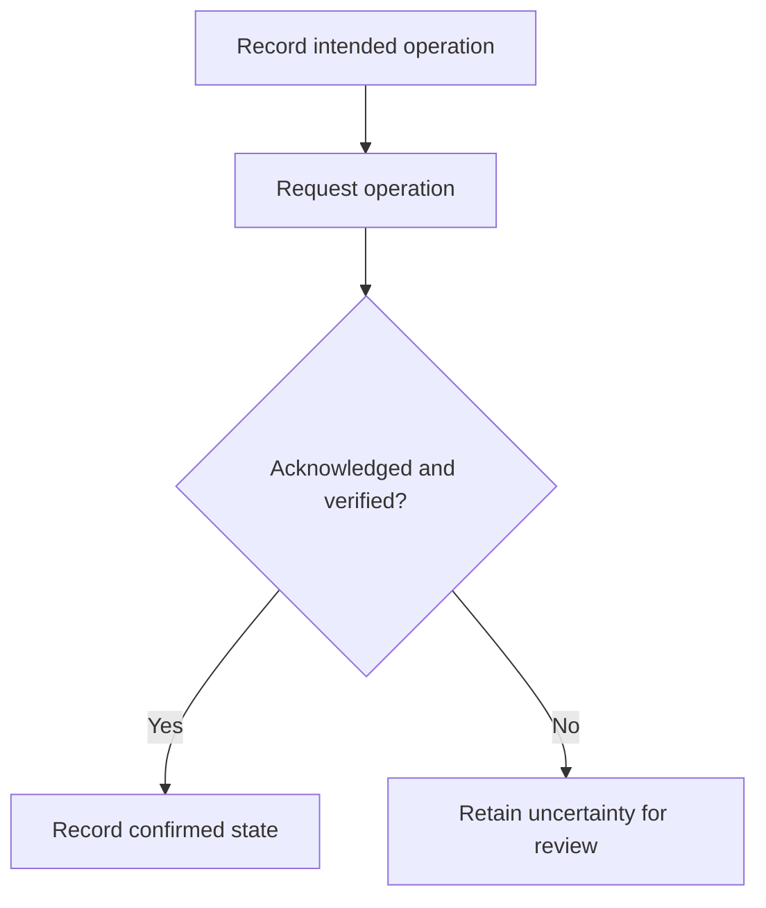

# Workflow reliability

**Focus:** making automation state and recovery decisions explicit.

**Implementation:** private. This public case study shares a concise method and bounded evidence, without infrastructure details, source paths, access information or operational records.

## The problem

An automation runner can lose a response while an operation continues. A visible service or a stopped-looking process alone is not enough evidence to declare an operation complete or safely start another writer.

## The contribution

- Record a checkpoint before requesting an operation.
- Preserve uncertainty when acknowledgment or verification is missing.
- Validate the exact target and lifecycle state before continuing.
- Keep recovery records separate from the accepted deployment’s history.
- Distinguish prepared recovery readiness from a demonstrated live recovery.

## Evidence

The reviewed recovery helper passed **37 deterministic offline tests**, independently rerun during the review. Tests covered unexpected settings, missing or pending operations, lost acknowledgments, competing writers, sequencing and preservation of prior records.

The exact helper was then staged and checked read-only against the working system. A separate recovery checkpoint was prepared and read back.

## Limits

**A live rollback drill was not performed.** Offline test success and a prepared checkpoint do not establish universal recovery effectiveness. Actual recovery remains a separately authorized, supervised operation. The implementation is kept private rather than exposed as a public deployment template.

[Back to the portfolio](../README.md)
